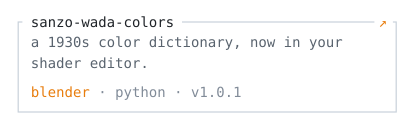
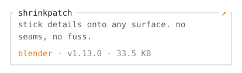
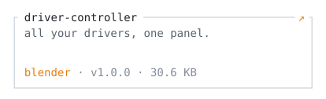
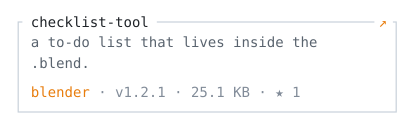
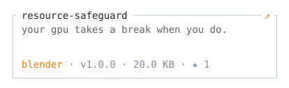
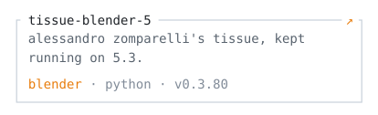
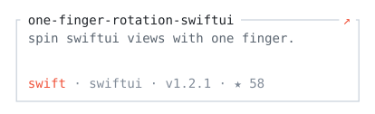
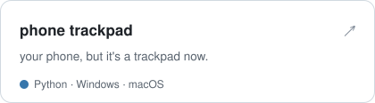

3D Artist, Generalist. I use Blender, Python and more. This github profile holds most of the tools I create and use.

### blender

<a href="https://github.com/mttfntn/sanzo-wada-colors-blender"><picture><source media="(prefers-color-scheme: dark)" srcset="cards/dark/sanzo-wada-colors.svg"></picture></a>
<a href="https://github.com/mttfntn/shrinkpatch-blender"><picture><source media="(prefers-color-scheme: dark)" srcset="cards/dark/shrinkpatch.svg"></picture></a>

<a href="https://github.com/mttfntn/driver-controller-blender"><picture><source media="(prefers-color-scheme: dark)" srcset="cards/dark/driver-controller.svg"></picture></a>
<a href="https://github.com/mttfntn/checklist-tool-blender"><picture><source media="(prefers-color-scheme: dark)" srcset="cards/dark/checklist-tool.svg"></picture></a>

<a href="https://github.com/mttfntn/resource-safeguard-blender"><picture><source media="(prefers-color-scheme: dark)" srcset="cards/dark/resource-safeguard.svg"></picture></a>
<a href="https://github.com/mttfntn/tissue-blender-5"><picture><source media="(prefers-color-scheme: dark)" srcset="cards/dark/tissue-blender-5.svg"></picture></a>

### elsewhere

<a href="https://github.com/mttfntn/OneFingerRotation"><picture><source media="(prefers-color-scheme: dark)" srcset="cards/dark/onefingerrotation.svg"></picture></a>
<a href="https://github.com/mttfntn/phone-trackpad"><picture><source media="(prefers-color-scheme: dark)" srcset="cards/dark/phone-trackpad.svg"></picture></a>

  
  
  
  
  
  

### 💻 Tech stack

### 🛠️ Software

